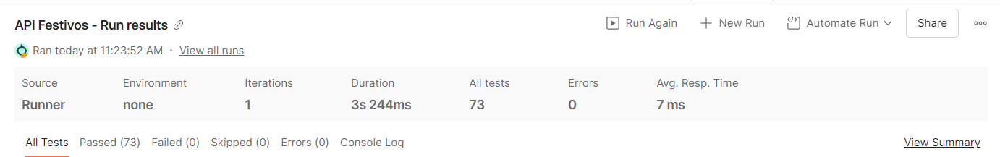

# Proyecto Arquitectura de Festivos

Proyecto desarrollado para la materia **Arquitectura de Software II**.

La API de Festivos fue desarrollada con **Node.js, Express, MongoDB y Mongoose**.

Permite:

- Consultar la configuración de festivos almacenada en MongoDB.
- Obtener los festivos correspondientes a un año.
- Verificar si una fecha es festiva.
- Crear festivos.
- Consultar festivos.
- Actualizar festivos.
- Eliminar festivos.
- Validar datos y fechas ingresadas.
- Documentar y probar los servicios mediante Swagger.
- Ejecutar pruebas automáticas mediante Postman.

---

# Requisitos

Antes de ejecutar el proyecto se debe tener instalado:

- Git
- Node.js
- npm
- MongoDB

Opcionalmente:

- MongoDB Compass
- Postman

---

# 1. Clonar el repositorio

Ejecutar:

```bash
git clone https://github.com/ivnmorales/Proyecto_Arquitectura_Festivos.git
```

Ingresar a la carpeta del proyecto:

```bash
cd Proyecto_Arquitectura_Festivos
```

---

# 2. Verificar MongoDB

MongoDB debe estar ejecutándose localmente en:

```text
mongodb://127.0.0.1:27017
```

Si se utiliza MongoDB Compass, conectarse con:

```text
mongodb://127.0.0.1:27017
```

En Windows también puede comprobarse el servicio desde PowerShell:

```powershell
Get-Service MongoDB
```

Si el servicio está detenido:

```powershell
Start-Service MongoDB
```

---

# 3. Cargar la base de datos

Desde la carpeta raíz del repositorio ejecutar:

```bash
npx mongosh "mongodb://127.0.0.1:27017/festivos" --file database/mongo/BDFestivos.mjs
```

El archivo utilizado para la carga se encuentra en:

```text
database/mongo/BDFestivos.mjs
```

La API utiliza la base de datos:

```text
festivos
```

y la colección:

```text
tipos
```

Este paso carga la configuración inicial necesaria para calcular los festivos.

> Si la base de datos ya fue cargada anteriormente, no es necesario volver a ejecutar el script.

---

# 4. Entrar a la API de Festivos

Ejecutar:

```bash
cd apis/festivos-api
```

---

# 5. Instalar las dependencias

Ejecutar:

```bash
npm install
```

Este comando instalará automáticamente las dependencias definidas en `package.json`.

Entre las principales dependencias utilizadas se encuentran:

- Express
- Mongoose
- Dotenv
- Swagger JSDoc
- Swagger UI Express
- Nodemon

---

# 6. Configurar variables de entorno

Dentro de:

```text
apis/festivos-api
```

crear un archivo llamado:

```text
.env
```

También se puede copiar el archivo `.env.example`.

En PowerShell:

```powershell
Copy-Item .env.example .env
```

El contenido debe quedar así:

```env
PORT=8080
MONGO_URI=mongodb://127.0.0.1:27017/festivos
```

---

# 7. Ejecutar la API

Desde:

```text
apis/festivos-api
```

ejecutar:

```bash
npm run dev
```

Si todo está correctamente configurado, la terminal mostrará mensajes similares a:

```text
MongoDB conectado correctamente
API Festivos ejecutándose en http://localhost:8080
```

La terminal debe permanecer abierta mientras se prueba la API.

---

# 8. Verificar que la API esté funcionando

Abrir en el navegador:

```text
http://localhost:8080/
```

La respuesta esperada es:

```json
{
  "mensaje": "API Festivos funcionando"
}
```

---

# 9. Swagger

La documentación interactiva de la API se encuentra disponible en:

```text
http://localhost:8080/api-docs
```

Desde Swagger se pueden consultar y probar los endpoints.

Para ejecutar una operación:

1. Abrir el endpoint.
2. Presionar **Try it out**.
3. Ingresar los parámetros o el cuerpo solicitado.
4. Presionar **Execute**.

---

# Endpoints principales

URL base:

```text
http://localhost:8080
```

## Consultar configuración de festivos

```http
GET /api/festivos/
```

Ejemplo:

```text
http://localhost:8080/api/festivos/
```

Devuelve los tipos de festivos y la configuración almacenada en MongoDB.

---

## Obtener los festivos de un año

```http
GET /api/festivos/obtener/:anio
```

Ejemplo:

```text
http://localhost:8080/api/festivos/obtener/2026
```

La API consulta la configuración almacenada en MongoDB y calcula las fechas correspondientes al año solicitado.

---

## Verificar si una fecha es festiva

```http
GET /api/festivos/verificar/:anio/:mes/:dia
```

Ejemplo:

```text
http://localhost:8080/api/festivos/verificar/2026/12/25
```

Ejemplo de respuesta:

```json
{
  "fecha": "2026-12-25",
  "esFestivo": true,
  "festivos": [
    "Navidad"
  ]
}
```

Si dos festivos coinciden en una misma fecha, la respuesta puede incluir ambos nombres dentro del arreglo `festivos`.

---

# CRUD de Festivos

## Crear un festivo

```http
POST /api/festivos/tipo/:tipoId/festivo
```

Ejemplo:

```text
POST http://localhost:8080/api/festivos/tipo/2/festivo
```

Body:

```json
{
  "dia": 9,
  "mes": 7,
  "nombre": "Festivo de prueba"
}
```

---

## Consultar un festivo

```http
GET /api/festivos/tipo/:tipoId/festivo/:nombre
```

Ejemplo:

```text
GET http://localhost:8080/api/festivos/tipo/1/festivo/Navidad
```

---

## Actualizar un festivo

```http
PUT /api/festivos/tipo/:tipoId/festivo/:nombre
```

Ejemplo:

```text
PUT http://localhost:8080/api/festivos/tipo/2/festivo/Festivo%20de%20prueba
```

Body:

```json
{
  "dia": 10,
  "mes": 7,
  "nombre": "Festivo actualizado"
}
```

---

## Eliminar un festivo

```http
DELETE /api/festivos/tipo/:tipoId/festivo/:nombre
```

Ejemplo:

```text
DELETE http://localhost:8080/api/festivos/tipo/2/festivo/Festivo%20actualizado
```

---

# Tipos de cálculo

La información de los festivos se obtiene desde MongoDB.

La API utiliza cuatro tipos de cálculo:

```text
Tipo 1
Fecha fija.

Tipo 2
Fecha trasladada al siguiente lunes.

Tipo 3
Fecha calculada con respecto al Domingo de Pascua.

Tipo 4
Fecha calculada con respecto al Domingo de Pascua
y posteriormente trasladada al siguiente lunes.
```

Los datos específicos de cada festivo se encuentran almacenados en MongoDB y la API aplica la regla correspondiente según su tipo.

La API también contempla fechas que dependen del año, como el **29 de febrero**.

Si existe un festivo configurado para el 29 de febrero:

- En un año bisiesto se calcula normalmente.
- En un año no bisiesto se omite.
- No se permite que JavaScript lo convierta automáticamente en una fecha de marzo.

---

# Pruebas con Postman

Las pruebas automatizadas de la API de Festivos se encuentran en:

```text
postman/test-api-festivos/
```

La colección utilizada es:

```text
postman/test-api-festivos/API_Festivos.postman_collection.json
```

La evidencia de ejecución se encuentra en:

```text
postman/test-api-festivos/evidencias/
```

---

## Importar la colección

Antes de ejecutar las pruebas:

1. Cargar la base de datos como se indica en el paso 3.
2. Ejecutar la API como se indica en el paso 7.
3. Abrir Postman.
4. Seleccionar **Import**.
5. Seleccionar el archivo:

```text
postman/test-api-festivos/API_Festivos.postman_collection.json
```

6. Abrir la colección **API Festivos test**.
7. Seleccionar **Run collection**.
8. Ejecutar la colección completa en el orden definido.

La variable de colección:

```text
baseUrl
```

tiene configurado por defecto:

```text
http://localhost:8080
```

Si la API se ejecuta en otro puerto, el valor puede modificarse desde la pestaña **Variables** de la colección.

---

## Contenido de la colección

| Carpeta | Pruebas realizadas |
|---|---|
| **1. Estado de la API** | Comprueba que la API esté activa y responda correctamente. |
| **2. Consultas** | Consulta la configuración, calcula festivos de diferentes años, verifica fechas festivas y no festivas y consulta festivos individuales. |
| **3. CRUD Festivos** | Crea un festivo temporal, lo consulta, verifica su cálculo, lo actualiza y posteriormente lo elimina. |
| **4. Validaciones y errores** | Comprueba fechas inválidas, años inválidos, datos incompletos, registros duplicados y recursos inexistentes. |
| **5. Caso especial - Año bisiesto** | Crea temporalmente un festivo el 29 de febrero, comprueba que no aparezca en 2026, que sí sea calculado en 2028 y posteriormente lo elimina. |

Cada solicitud contiene pruebas automáticas que validan tanto el código HTTP como los datos devueltos por la API.

Entre las pruebas realizadas se comprueba:

- Respuesta `200` al consultar correctamente la API.
- Respuesta `201` al crear un festivo.
- Respuesta `400` ante datos inválidos.
- Respuesta `404` al consultar recursos inexistentes.
- Navidad de 2026 en `2026-12-25`.
- Santos Reyes trasladado al lunes correspondiente.
- Viernes Santo calculado con respecto a Pascua.
- Corpus Christi calculado con respecto a Pascua y ley de puente.
- Coincidencia de dos festivos en una misma fecha.
- Orden cronológico de los festivos.
- Funcionamiento completo del CRUD.
- Validación del 29 de febrero en años bisiestos y no bisiestos.

Las pruebas que crean información temporal también eliminan dicha información al finalizar, por lo que la ejecución completa no deja registros de prueba permanentes en la base de datos.

---

## Resultado de las pruebas

La colección **API Festivos test** fue ejecutada mediante **Postman Collection Runner**.

Resultado obtenido:

```text
Pruebas ejecutadas: 73
Pruebas aprobadas: 73
Pruebas fallidas: 0
Errores: 0
```

### Evidencia de ejecución



La imagen anterior corresponde a la ejecución completa de la colección en Postman Collection Runner.

---

## Uso manual de Postman

Los mismos endpoints documentados en Swagger pueden probarse manualmente desde Postman.

URL base:

```text
http://localhost:8080
```

Para solicitudes `POST` y `PUT` utilizar:

```text
Body → raw → JSON
```

con:

```text
Content-Type: application/json
```

---

# Estructura principal del proyecto

```text
Proyecto_Arquitectura_Festivos/
│
├── apis/
│   └── festivos-api/
│       ├── src/
│       │   ├── config/
│       │   ├── controllers/
│       │   ├── middleware/
│       │   ├── models/
│       │   ├── repositories/
│       │   ├── routes/
│       │   ├── services/
│       │   ├── app.js
│       │   └── index.js
│       │
│       ├── .env.example
│       ├── package.json
│       └── package-lock.json
│
├── database/
│   └── mongo/
│       └── BDFestivos.mjs
│
├── diagramas/
│
├── postman/
│   └── test-api-festivos/
│       ├── API_Festivos.postman_collection.json
│       └── evidencias/
│           └── resultado_collection_runner.png
│
├── .gitignore
└── README.md
```

---

# Resumen rápido de ejecución

Clonar el repositorio:

```bash
git clone https://github.com/ivnmorales/Proyecto_Arquitectura_Festivos.git
```

Ingresar al proyecto:

```bash
cd Proyecto_Arquitectura_Festivos
```

Cargar la base de datos:

```bash
npx mongosh "mongodb://127.0.0.1:27017/festivos" --file database/mongo/BDFestivos.mjs
```

Ingresar a la API:

```bash
cd apis/festivos-api
```

Instalar dependencias:

```bash
npm install
```

Crear el archivo:

```text
.env
```

con:

```env
PORT=8080
MONGO_URI=mongodb://127.0.0.1:27017/festivos
```

Ejecutar:

```bash
npm run dev
```

Abrir Swagger:

```text
http://localhost:8080/api-docs
```

Para ejecutar las pruebas automatizadas, importar en Postman:

```text
postman/test-api-festivos/API_Festivos.postman_collection.json
```