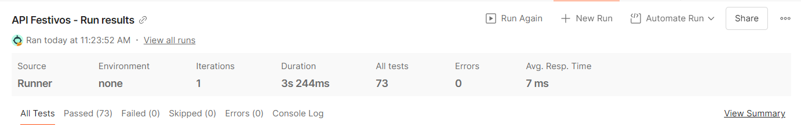
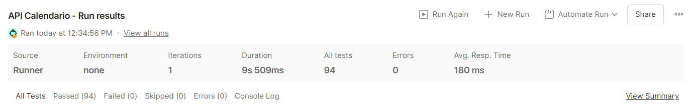

# Proyecto Arquitectura de Festivos

Proyecto desarrollado para la materia **Arquitectura de Software II**.

La API de Festivos fue desarrollada con **Node.js, Express, MongoDB y Mongoose**.

Permite:

- Consultar la configuración de festivos almacenada en MongoDB.
- Obtener los festivos correspondientes a un año.
- Verificar si una fecha es festiva.
- Crear festivos.
- Consultar festivos.
- Actualizar festivos.
- Eliminar festivos.
- Validar datos y fechas ingresadas.
- Documentar y probar los servicios mediante Swagger.
- Ejecutar pruebas automáticas mediante Postman.

La API de Calendario fue desarrollada con **Java, Spring Boot (Maven multi-módulo), Spring Data JPA y PostgreSQL**.

Permite:

- Generar el calendario laboral de un año, clasificando cada día como **Día laboral**, **Fin de Semana** o **Día festivo**.
- Consultar los festivos del año en la API de Festivos.
- Guardar y consultar el calendario en PostgreSQL.
- Administrar los tipos de día (CRUD de la tabla `Tipo`).
- Documentar y probar los servicios mediante Swagger y Postman.

La documentación de la API de Calendario se encuentra en la sección [API Calendario](#api-calendario).

---

# Requisitos

Antes de ejecutar el proyecto se debe tener instalado:

- Git
- Node.js
- npm
- MongoDB
- Java (JDK 21 o superior)
- Maven
- PostgreSQL

Opcionalmente:

- MongoDB Compass
- pgAdmin
- Postman

---

# 1. Clonar el repositorio

Ejecutar:

```bash
git clone https://github.com/ivnmorales/Proyecto_Arquitectura_Festivos.git
```

Ingresar a la carpeta del proyecto:

```bash
cd Proyecto_Arquitectura_Festivos
```

---

# 2. Verificar MongoDB

MongoDB debe estar ejecutándose localmente en:

```text
mongodb://127.0.0.1:27017
```

Si se utiliza MongoDB Compass, conectarse con:

```text
mongodb://127.0.0.1:27017
```

En Windows también puede comprobarse el servicio desde PowerShell:

```powershell
Get-Service MongoDB
```

Si el servicio está detenido:

```powershell
Start-Service MongoDB
```

---

# 3. Cargar la base de datos

Desde la carpeta raíz del repositorio ejecutar:

```bash
npx mongosh "mongodb://127.0.0.1:27017/festivos" --file database/mongo/BDFestivos.mjs
```

El archivo utilizado para la carga se encuentra en:

```text
database/mongo/BDFestivos.mjs
```

La API utiliza la base de datos:

```text
festivos
```

y la colección:

```text
tipos
```

Este paso carga la configuración inicial necesaria para calcular los festivos.

> Si la base de datos ya fue cargada anteriormente, no es necesario volver a ejecutar el script.

---

# 4. Entrar a la API de Festivos

Ejecutar:

```bash
cd apis/festivos-api
```

---

# 5. Instalar las dependencias

Ejecutar:

```bash
npm install
```

Este comando instalará automáticamente las dependencias definidas en `package.json`.

Entre las principales dependencias utilizadas se encuentran:

- Express
- Mongoose
- Dotenv
- Swagger JSDoc
- Swagger UI Express
- Nodemon

---

# 6. Configurar variables de entorno

Dentro de:

```text
apis/festivos-api
```

crear un archivo llamado:

```text
.env
```

También se puede copiar el archivo `.env.example`.

En PowerShell:

```powershell
Copy-Item .env.example .env
```

El contenido debe quedar así:

```env
PORT=8080
MONGO_URI=mongodb://127.0.0.1:27017/festivos
```

---

# 7. Ejecutar la API

Desde:

```text
apis/festivos-api
```

ejecutar:

```bash
npm run dev
```

Si todo está correctamente configurado, la terminal mostrará mensajes similares a:

```text
MongoDB conectado correctamente
API Festivos ejecutándose en http://localhost:8080
```

La terminal debe permanecer abierta mientras se prueba la API.

---

# 8. Verificar que la API esté funcionando

Abrir en el navegador:

```text
http://localhost:8080/
```

La respuesta esperada es:

```json
{
  "mensaje": "API Festivos funcionando"
}
```

---

# 9. Swagger

La documentación interactiva de la API se encuentra disponible en:

```text
http://localhost:8080/api-docs
```

Desde Swagger se pueden consultar y probar los endpoints.

Para ejecutar una operación:

1. Abrir el endpoint.
2. Presionar **Try it out**.
3. Ingresar los parámetros o el cuerpo solicitado.
4. Presionar **Execute**.

---

# Endpoints principales

URL base:

```text
http://localhost:8080
```

## Consultar configuración de festivos

```http
GET /api/festivos/
```

Ejemplo:

```text
http://localhost:8080/api/festivos/
```

Devuelve los tipos de festivos y la configuración almacenada en MongoDB.

---

## Obtener los festivos de un año

```http
GET /api/festivos/obtener/:anio
```

Ejemplo:

```text
http://localhost:8080/api/festivos/obtener/2026
```

La API consulta la configuración almacenada en MongoDB y calcula las fechas correspondientes al año solicitado.

---

## Verificar si una fecha es festiva

```http
GET /api/festivos/verificar/:anio/:mes/:dia
```

Ejemplo:

```text
http://localhost:8080/api/festivos/verificar/2026/12/25
```

Ejemplo de respuesta:

```json
{
  "fecha": "2026-12-25",
  "esFestivo": true,
  "festivos": [
    "Navidad"
  ]
}
```

Si dos festivos coinciden en una misma fecha, la respuesta puede incluir ambos nombres dentro del arreglo `festivos`.

---

# CRUD de Festivos

## Crear un festivo

```http
POST /api/festivos/tipo/:tipoId/festivo
```

Ejemplo:

```text
POST http://localhost:8080/api/festivos/tipo/2/festivo
```

Body:

```json
{
  "dia": 9,
  "mes": 7,
  "nombre": "Festivo de prueba"
}
```

---

## Consultar un festivo

```http
GET /api/festivos/tipo/:tipoId/festivo/:nombre
```

Ejemplo:

```text
GET http://localhost:8080/api/festivos/tipo/1/festivo/Navidad
```

---

## Actualizar un festivo

```http
PUT /api/festivos/tipo/:tipoId/festivo/:nombre
```

Ejemplo:

```text
PUT http://localhost:8080/api/festivos/tipo/2/festivo/Festivo%20de%20prueba
```

Body:

```json
{
  "dia": 10,
  "mes": 7,
  "nombre": "Festivo actualizado"
}
```

---

## Eliminar un festivo

```http
DELETE /api/festivos/tipo/:tipoId/festivo/:nombre
```

Ejemplo:

```text
DELETE http://localhost:8080/api/festivos/tipo/2/festivo/Festivo%20actualizado
```

---

# Tipos de cálculo

La información de los festivos se obtiene desde MongoDB.

La API utiliza cuatro tipos de cálculo:

```text
Tipo 1
Fecha fija.

Tipo 2
Fecha trasladada al siguiente lunes.

Tipo 3
Fecha calculada con respecto al Domingo de Pascua.

Tipo 4
Fecha calculada con respecto al Domingo de Pascua
y posteriormente trasladada al siguiente lunes.
```

Los datos específicos de cada festivo se encuentran almacenados en MongoDB y la API aplica la regla correspondiente según su tipo.

La API también contempla fechas que dependen del año, como el **29 de febrero**.

Si existe un festivo configurado para el 29 de febrero:

- En un año bisiesto se calcula normalmente.
- En un año no bisiesto se omite.
- No se permite que JavaScript lo convierta automáticamente en una fecha de marzo.

---

# Pruebas con Postman

Las pruebas automatizadas de la API de Festivos se encuentran en:

```text
postman/test-api-festivos/
```

La colección utilizada es:

```text
postman/test-api-festivos/API_Festivos.postman_collection.json
```

La evidencia de ejecución se encuentra en:

```text
postman/test-api-festivos/evidencias/
```

---

## Importar la colección

Antes de ejecutar las pruebas:

1. Cargar la base de datos como se indica en el paso 3.
2. Ejecutar la API como se indica en el paso 7.
3. Abrir Postman.
4. Seleccionar **Import**.
5. Seleccionar el archivo:

```text
postman/test-api-festivos/API_Festivos.postman_collection.json
```

6. Abrir la colección **API Festivos**.
7. Seleccionar **Run collection**.
8. Ejecutar la colección completa en el orden definido.

La variable de colección:

```text
baseUrl
```

tiene configurado por defecto:

```text
http://localhost:8080
```

Si la API se ejecuta en otro puerto, el valor puede modificarse desde la pestaña **Variables** de la colección.

---

## Contenido de la colección

| Carpeta | Pruebas realizadas |
|---|---|
| **1. Estado de la API** | Comprueba que la API esté activa y responda correctamente. |
| **2. Consultas** | Consulta la configuración, calcula festivos de diferentes años, verifica fechas festivas y no festivas y consulta festivos individuales. |
| **3. CRUD Festivos** | Crea un festivo temporal, lo consulta, verifica su cálculo, lo actualiza y posteriormente lo elimina. |
| **4. Validaciones y errores** | Comprueba fechas inválidas, años inválidos, datos incompletos, registros duplicados y recursos inexistentes. |
| **5. Caso especial - Año bisiesto** | Crea temporalmente un festivo el 29 de febrero, comprueba que no aparezca en 2026, que sí sea calculado en 2028 y posteriormente lo elimina. |

Cada solicitud contiene pruebas automáticas que validan tanto el código HTTP como los datos devueltos por la API.

Entre las pruebas realizadas se comprueba:

- Respuesta `200` al consultar correctamente la API.
- Respuesta `201` al crear un festivo.
- Respuesta `400` ante datos inválidos.
- Respuesta `404` al consultar recursos inexistentes.
- Navidad de 2026 en `2026-12-25`.
- Santos Reyes trasladado al lunes correspondiente.
- Viernes Santo calculado con respecto a Pascua.
- Corpus Christi calculado con respecto a Pascua y ley de puente.
- Coincidencia de dos festivos en una misma fecha.
- Orden cronológico de los festivos.
- Funcionamiento completo del CRUD.
- Validación del 29 de febrero en años bisiestos y no bisiestos.

Las pruebas que crean información temporal también eliminan dicha información al finalizar, por lo que la ejecución completa no deja registros de prueba permanentes en la base de datos.

---

## Resultado de las pruebas

La colección **API Festivos** fue ejecutada mediante **Postman Collection Runner**.

Resultado obtenido:

```text
Pruebas ejecutadas: 73
Pruebas aprobadas: 73
Pruebas fallidas: 0
Errores: 0
```

### Evidencia de ejecución



La imagen anterior corresponde a la ejecución completa de la colección en Postman Collection Runner.

---

## Uso manual de Postman

Los mismos endpoints documentados en Swagger pueden probarse manualmente desde Postman.

URL base:

```text
http://localhost:8080
```

Para solicitudes `POST` y `PUT` utilizar:

```text
Body → raw → JSON
```

con:

```text
Content-Type: application/json
```

---

# API Calendario

La API de Calendario consulta los festivos del año en la API de Festivos, recorre todos los días del 1 de enero al 31 de diciembre y los guarda en PostgreSQL con la siguiente prioridad:

| Condición | Tipo | Descripción |
|---|---|---|
| La fecha es festiva | Día festivo | Nombre del festivo |
| No es festiva y es sábado o domingo | Fin de Semana | `null` |
| Cualquier otro día | Día laboral | `null` |

Si varios festivos caen el mismo día, se guarda un solo registro con todos los nombres (por ejemplo `San Pedro y San Pablo / Sagrado Corazón de Jesús`).

Un año normal genera **365** registros y un año bisiesto **366**. Generar de nuevo un año reemplaza sus registros, sin duplicar fechas.

---

## C1. Crear la base de datos CalendarioLaboral

Los scripts se encuentran en:

```text
database/postgresql/DDL - Calendario Laboral.sql
database/postgresql/DML - Calendario Laboral.sql
```

Desde pgAdmin (o cualquier cliente PostgreSQL):

1. Conectado a la base `postgres`, ejecutar del DDL solo la instrucción:

```sql
CREATE DATABASE CalendarioLaboral;
```

> La instrucción `DROP DATABASE` del DDL elimina la base existente con todos sus datos. Solo debe ejecutarse si se quiere crear la base desde cero.

2. Cambiar la conexión a la base `calendariolaboral` y ejecutar el resto del DDL (tablas `Tipo` y `Calendario` con sus índices).
3. Ejecutar el DML para registrar los tipos:

```text
1 = Día laboral
2 = Fin de Semana
3 = Día festivo
```

> PostgreSQL guarda los nombres sin comillas en minúsculas, por eso la base queda como `calendariolaboral`.

Las tablas no las crea la aplicación (`spring.jpa.hibernate.ddl-auto=none`).

---

## C2. Configurar la conexión

La configuración está en:

```text
apis/calendario-api/presentacion/src/main/resources/application.properties
```

Valores por defecto:

| Propiedad | Variable de entorno | Valor por defecto |
|---|---|---|
| Puerto | `SERVER_PORT` | `8081` |
| URL de la base | `DB_URL` | `jdbc:postgresql://localhost:5432/calendariolaboral` |
| Usuario | `DB_USERNAME` | `postgres` |
| Contraseña | `DB_PASSWORD` | *(vacía)* |
| URL de la API Festivos | `FESTIVOS_API_URL` | `http://localhost:8080/api/festivos` |

La contraseña de PostgreSQL **no se guarda en el repositorio**. Se define como variable de entorno en la terminal donde se ejecutará la API.

PowerShell:

```powershell
$env:DB_PASSWORD = "tu_contraseña"
```

CMD:

```bat
set DB_PASSWORD=tu_contraseña
```

---

## C3. Compilar

```bash
cd apis/calendario-api
```

```bash
mvn clean install
```

Al finalizar debe mostrarse `BUILD SUCCESS` y generarse el archivo:

```text
apis/calendario-api/presentacion/target/presentacion-1.0.0.jar
```

---

## C4. Ejecutar Festivos y Calendario al mismo tiempo

La API de Calendario necesita que la API de Festivos esté ejecutándose. Se usan **dos terminales**.

Terminal 1 - API Festivos (puerto 8080, con MongoDB encendido):

```bash
cd apis/festivos-api
```

```bash
npm start
```

Terminal 2 - API Calendario (puerto 8081, con PostgreSQL encendido y `DB_PASSWORD` definido):

```bash
cd apis/calendario-api
```

```bash
java -jar presentacion/target/presentacion-1.0.0.jar
```

Si la ejecución es correcta, la terminal mostrará:

```text
Tomcat started on port 8081
Started ApiApplication
```

---

## C5. Swagger

```text
http://localhost:8081/swagger-ui.html
```

---

## C6. Endpoints

### Generar el calendario de un año

```http
POST http://localhost:8081/api/calendario/generar/{anio}
```

Ejemplo:

```text
POST http://localhost:8081/api/calendario/generar/2026
```

Respuesta:

```json
true
```

### Obtener el calendario de un año

```http
GET http://localhost:8081/api/calendario/obtener/{anio}
```

Ejemplo:

```text
GET http://localhost:8081/api/calendario/obtener/2026
```

Respuesta (fragmento):

```json
[
  {
    "id": 1,
    "fecha": "2026-01-01",
    "tipo": { "id": 3, "tipo": "Día festivo" },
    "descripcion": "Año nuevo"
  },
  {
    "id": 2,
    "fecha": "2026-01-02",
    "tipo": { "id": 1, "tipo": "Día laboral" },
    "descripcion": null
  }
]
```

### CRUD de Tipo

La tabla `Tipo` se administra desde la API, sin entrar a la base de datos:

| Método | Ruta | Descripción |
|---|---|---|
| `GET` | `/api/tipos/listar` | Lista todos los tipos ordenados por Id |
| `GET` | `/api/tipos/obtener/{id}` | Obtiene un tipo por Id |
| `GET` | `/api/tipos/buscar/{nombre}` | Busca tipos cuyo nombre contiene el texto (sin distinguir mayúsculas) |
| `POST` | `/api/tipos/agregar` | Agrega un tipo (el Id lo asigna la API) |
| `PUT` | `/api/tipos/modificar` | Modifica el nombre de un tipo |
| `DELETE` | `/api/tipos/eliminar/{id}` | Elimina un tipo y responde `true` |

Ejemplo para agregar:

```text
POST http://localhost:8081/api/tipos/agregar
```

```json
{
  "tipo": "Día cívico"
}
```

Ejemplo para modificar:

```text
PUT http://localhost:8081/api/tipos/modificar
```

```json
{
  "id": 4,
  "tipo": "Día cívico nacional"
}
```

Reglas:

- El nombre es obligatorio, de máximo 100 caracteres, y no puede repetirse (sin distinguir mayúsculas).
- Los tipos **1 (Día laboral)**, **2 (Fin de Semana)** y **3 (Día festivo)** se pueden modificar, pero no eliminar, porque los usa la generación del calendario.

### Errores

| Código | Caso |
|---|---|
| `400` | Año inválido (no numérico, menor que 1 o mayor que 9999), Id no numérico, nombre de Tipo vacío o JSON mal formado |
| `404` | El Tipo no existe |
| `409` | Nombre de Tipo repetido, o Tipo requerido o en uso |
| `502` | No fue posible consumir la API de Festivos |
| `500` | Falta un registro de `Tipo` en PostgreSQL u otro error inesperado |

---

## C7. Pruebas con Postman

La colección se encuentra en:

```text
postman/test-api-calendario/API_Calendario.postman_collection.json
```

Importarla en Postman y ejecutarla con **Run collection**, con las dos APIs en ejecución. La variable `baseUrl` tiene por defecto `http://localhost:8081`.

| Carpeta | Pruebas realizadas |
|---|---|
| **1. Estado de la API** | Swagger documenta los endpoints de Calendario y de Tipo. |
| **2. Generar y obtener 2026** | 365 días ordenados; Navidad, Santos Reyes y Domingo de Pascua como Día festivo; un lunes como Día laboral y un sábado como Fin de Semana. |
| **3. Regenerar sin duplicados** | Generar 2026 de nuevo mantiene 365 fechas únicas. |
| **4. Año bisiesto** | 2028 genera 366 días, incluido el 29 de febrero. |
| **5. Festivos coincidentes** | En 2025 el 30 de junio es un solo registro con ambos festivos. |
| **6. Validaciones y errores** | Años inválidos (`0`, `10000`, `abc`) y método no permitido. |
| **7. CRUD Tipo** | Lista, obtiene y busca tipos; agrega un tipo temporal, lo modifica y lo elimina; valida nombre vacío o repetido (400/409), tipos inexistentes (404) y que el tipo 1 no se pueda eliminar (409). |

La colección genera los años 2025, 2026 y 2028. Como la generación reemplaza el año completo y la carpeta de Tipo elimina el tipo que crea, puede ejecutarse varias veces.

### Resultado de las pruebas

La colección **API Calendario** fue ejecutada mediante **Postman Collection Runner**.

Resultado obtenido:

```text
Pruebas ejecutadas: 94
Pruebas aprobadas: 94
Pruebas fallidas: 0
Errores: 0
```

### Evidencia de ejecución



---

# Estructura principal del proyecto

```text
Proyecto_Arquitectura_Festivos/
│
├── apis/
│   ├── festivos-api/
│   │   ├── src/
│   │   │   ├── config/
│   │   │   ├── controllers/
│   │   │   ├── middleware/
│   │   │   ├── models/
│   │   │   ├── repositories/
│   │   │   ├── routes/
│   │   │   ├── services/
│   │   │   ├── app.js
│   │   │   └── index.js
│   │   │
│   │   ├── .env.example
│   │   ├── package.json
│   │   └── package-lock.json
│   │
│   └── calendario-api/
│       ├── pom.xml
│       ├── dominio/          (Calendario, Tipo)
│       ├── core/             (interfaces, FestivoExterno, excepciones)
│       ├── aplicacion/       (CalendarioServicio)
│       ├── infraestructura/  (JPA, mapeadores, integración con Festivos)
│       └── presentacion/     (ApiApplication, controlador, Swagger, errores)
│
├── database/
│   ├── mongo/
│   │   └── BDFestivos.mjs
│   │
│   └── postgresql/
│       ├── DDL - Calendario Laboral.sql
│       └── DML - Calendario Laboral.sql
│
├── diagramas/
│   ├── festivos_API/
│   └── calendario_API/
│
├── postman/
│   ├── test-api-festivos/
│   │   ├── API_Festivos.postman_collection.json
│   │   └── evidencias/
│   │       └── resultado_collection_runner.png
│   │
│   └── test-api-calendario/
│       ├── API_Calendario.postman_collection.json
│       └── evidencias/
│           └── resultado_collection_runner.png
│
├── .gitignore
└── README.md
```

---

# Resumen rápido de ejecución

Clonar el repositorio:

```bash
git clone https://github.com/ivnmorales/Proyecto_Arquitectura_Festivos.git
```

Ingresar al proyecto:

```bash
cd Proyecto_Arquitectura_Festivos
```

Cargar la base de datos:

```bash
npx mongosh "mongodb://127.0.0.1:27017/festivos" --file database/mongo/BDFestivos.mjs
```

Ingresar a la API:

```bash
cd apis/festivos-api
```

Instalar dependencias:

```bash
npm install
```

Crear el archivo:

```text
.env
```

con:

```env
PORT=8080
MONGO_URI=mongodb://127.0.0.1:27017/festivos
```

Ejecutar:

```bash
npm run dev
```

Abrir Swagger:

```text
http://localhost:8080/api-docs
```

Para ejecutar las pruebas automatizadas, importar en Postman:

```text
postman/test-api-festivos/API_Festivos.postman_collection.json
```

## API Calendario

Con la API de Festivos en ejecución y la base `CalendarioLaboral` creada (ver [C1](#c1-crear-la-base-de-datos-calendariolaboral)), en otra terminal (PowerShell):

```powershell
cd apis/calendario-api
```

```powershell
$env:DB_PASSWORD = "tu_contraseña"
```

```powershell
mvn clean install
```

```powershell
java -jar presentacion/target/presentacion-1.0.0.jar
```

Abrir Swagger:

```text
http://localhost:8081/swagger-ui.html
```

Probar:

```text
POST http://localhost:8081/api/calendario/generar/2026
GET  http://localhost:8081/api/calendario/obtener/2026
```

Para ejecutar las pruebas automatizadas, importar en Postman:

```text
postman/test-api-calendario/API_Calendario.postman_collection.json
```